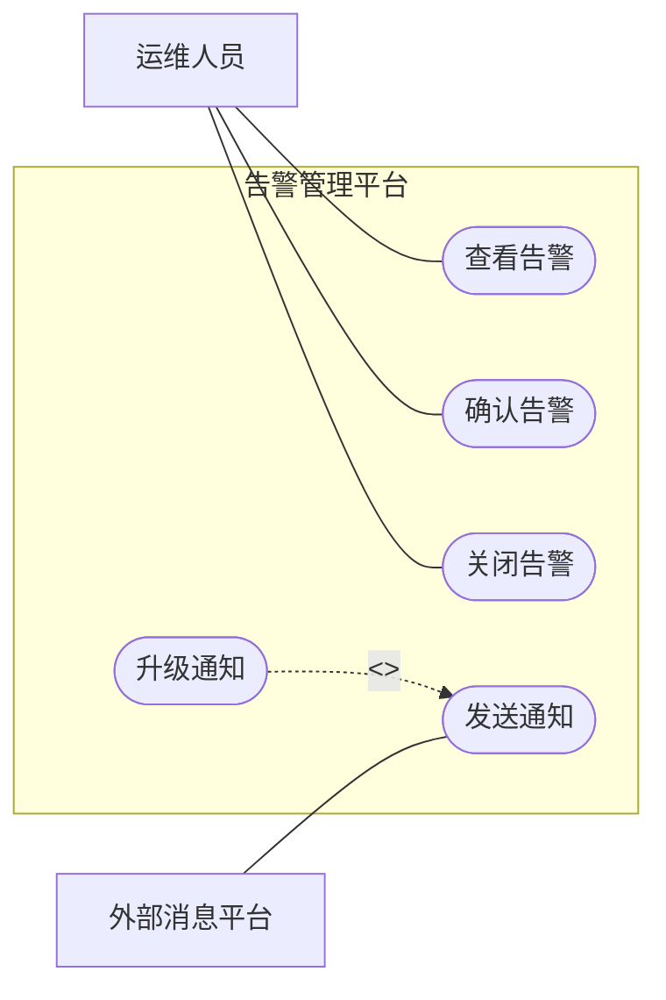

# UML 用例图：从系统外部看清“谁使用系统、系统提供什么功能”

> [!summary]- 快速复习卡片（学完再看）
> **用例图回答**：谁（参与者）会使用系统？系统对外提供哪些功能？  
> **参与者 Actor**：位于系统边界之外、与系统交互的角色，可以是人，也可以是外部系统。  
> **用例 Use Case**：系统对外提供的一项有意义的功能，通常用“动词 + 对象”命名。  
> **系统边界**：明确本次讨论的系统范围；功能在边界内，参与者在边界外。  
> **include**：基础用例每次执行都需要包含的行为；箭头由基础用例指向被包含用例。  
> **extend**：条件满足时附加到基础用例上的可选行为；箭头由扩展用例指向基础用例。  
> **泛化**：表达“是一种”的继承关系；箭头指向更一般的父角色或父用例。

[[UML总览]] 已经说明：不同 UML 图回答不同问题。用例图是最靠近需求的一种图，因为它先不讨论软件内部怎么实现，而是先弄清楚**外部角色需要系统提供什么服务**。

下面只使用一个例子：**告警管理平台**。不在章节中途换成商城或其他系统。

## 1. 用例图究竟解决什么问题？

假设我们要建设一个告警管理平台。需求人员已经知道：

- 运维人员需要查看告警、确认告警、关闭告警；
- 平台需要把告警通知发送到外部消息平台；
- 严重告警在规定时间内没有被确认时，需要升级通知。

这时还没有决定用哪些 Java 类、数据库表或微服务。我们首先要回答：

> **谁会和告警管理平台交互？平台需要向这些外部角色提供哪些功能？**

这就是用例图的工作。它把系统当作一个“黑盒子”：先描述系统对外能做什么，不展开盒子内部如何完成。

## 2. 先认清用例图的四个基本元素

### 参与者（Actor）：谁在系统外部与它交互？

参与者表示一个**外部角色**，不是某个具体的人，也不一定是人。

在告警管理平台中：

- **运维人员**：查看、确认和关闭告警；
- **外部消息平台**：接收平台发出的通知。

不要把系统内部的数据库、告警处理类、通知服务类画成参与者。它们是系统内部的实现部分，不是站在系统边界外与系统交互的角色。

### 用例（Use Case）：系统对外提供什么功能？

用例表示系统提供的一项有意义的功能，通常用“动词 + 对象”命名，例如：

- 查看告警
- 确认告警
- 关闭告警
- 发送通知
- 升级通知

“写入 alert 表”“调用 `save()` 方法”通常是内部实现步骤，不是面向外部角色的用例。

### 系统边界：本次把什么算作这个系统？

边界框里面是告警管理平台提供的用例；边界框外面是运维人员、外部消息平台等参与者。

边界不是装饰。它决定了一个对象究竟是“系统内部功能”，还是“系统外部角色”。

### 关联（Association）：参与者会使用哪个用例？

参与者与用例之间的实线表示它们之间存在交互关系。例如，运维人员关联“查看告警”和“确认告警”；告警管理平台与外部消息平台通过“发送通知”用例发生交互。

关联只表达“存在交互”，**不表示调用先后顺序**。要表达一次运行中谁先调用谁，应看 [[UML序列图与通信图]]。

## 3. 用一张图看懂整体结构

下面是告警管理平台的简化用例关系示意。它用于帮助理解元素和关系；正式答题时应按 UML 规范识别参与者、用例、系统边界及关系。

这张图先让我们看清三件事：

1. 运维人员和外部消息平台是系统外部的参与者；
2. 查看告警、确认告警、关闭告警、发送通知等是平台对外提供的功能；
3. “升级通知”是满足特定条件时才发生的扩展行为，因此示意为扩展“发送通知”。

图里没有画告警类、数据库表和服务调用链，因为它们不是用例图的重点。

## 4. 四种关系是重点：尤其要分清 include 和 extend

用例图中常见的关系包括：**关联、包含（include）、扩展（extend）、泛化**。考试尤其容易混淆 include 与 extend；判断时不要只背英文，要先看业务行为是不是必需。

### 4.1 关联：有交互就连起来

例如，运维人员可以“查看告警”。用实线连接参与者和用例，表示二者存在交互。

- 它回答：**谁会使用这项功能？**
- 它不回答：功能内部有哪些步骤，也不表示执行顺序。

### 4.2 包含（include）：基础功能每次都必须做的公共行为

假设平台的“确认告警”每次执行时，都必须先“验证操作权限”。

如果“验证操作权限”是确认告警必不可少的一部分，可以把它抽成一个被包含用例：

**看图：箭头从左向右。基础用例“确认告警”指向被包含用例“验证操作权限”。**

把它读成：“确认告警”包含“验证操作权限”。每次执行确认告警，都必须执行权限验证。

include 也常用于抽取多个用例都会重复使用的公共行为，避免重复描述。

### 4.3 扩展（extend）：条件满足时才附加的可选行为

假设平台发送普通通知后，通常流程就结束了；只有当告警严重且长时间无人确认时，才需要“升级通知”。

那么“升级通知”是在特定条件下给原有通知流程增加的行为，可以用 extend 表达。为了让箭头方向与 include 图形成明显对比，这张图按**从右向左**排布：

**看图：箭头从右向左。扩展用例“升级通知”指向被扩展的基础用例“发送通知”。**

注意：这里改变的是图的排布方向，不是 UML 关系规则。extend 的箭头始终从扩展用例指向基础用例。

把它读成：“升级通知”在特定条件下扩展“发送通知”。基础用例本身仍然有意义，不要求每次发送通知都升级。

### 4.4 include 和 extend 到底怎么判断？

| 判断问题 | include | extend |
| --- | --- | --- |
| 另一个行为是不是基础用例每次都必须包含的部分？ | 是，通常选 include | 不一定；只在条件满足时发生 |
| 基础用例能否不带这段行为而独立成立？ | 该必需行为不能省略 | 可以，扩展行为不是每次都发生 |
| 箭头从哪里指向哪里？ | 基础用例 → 被包含用例 | 扩展用例 → 基础用例 |
| 告警平台例子 | 确认告警 → 验证操作权限 | 升级通知 → 发送通知 |

**最直观的区别：** include 图的箭头指向右侧的“被包含用例”；extend 图特意把扩展用例放在右侧，箭头反向指回左侧的基础用例。正式 UML 中两者都使用带 «include» 或 «extend» 标注的虚线依赖箭头，不能靠线型区分，必须看箭头方向、标注和业务含义。

记忆时不要把 include 理解成普通的“引用”，也不要把 extend 理解成面向对象的“继承”。它们描述的是**用例之间的行为组织关系**，不是类之间的关系。

### 4.5 泛化：一个特殊角色/用例属于更一般的角色/用例

例如，平台中存在“值班运维人员”和更一般的“运维人员”角色。如果值班运维人员是一种运维人员，并继承其一般交互能力，可以用参与者泛化表达。

泛化也可以发生在用例之间：特殊用例是一般用例的一种具体化。

泛化箭头的空心三角形指向**更一般的父角色或父用例**。它表达“是一种”，与 include、extend 的行为复用/扩展不是一回事。

## 5. 实际画图时，按什么顺序做？

拿到需求后，按以下顺序识别，不要一开始就急着画 include/extend：

1. **确定系统范围**：这次要描述的系统叫什么？哪些功能归它负责？
2. **找参与者**：谁在系统外部与它交互？有没有外部系统？
3. **找用例**：每个参与者希望系统完成什么有意义的目标？用“动词 + 对象”命名。
4. **连关联**：先连清楚哪个参与者使用哪个用例。
5. **再判断用例之间的关系**：只有确实存在必需公共行为、条件扩展或泛化时，才添加 include、extend 或泛化。
6. **回看需求查漏**：每条重要的外部需求是否有对应功能？是否误把数据库、内部类、方法调用画成参与者或用例？

**不要为了让图显得复杂而滥用 include/extend。** 先把“谁使用什么功能”画准确，往往比堆很多关系更重要。

## 6. 用例图与其他 UML 图有什么区别？

| 题目真正想问什么 | 优先想到的图 | 原因 |
| --- | --- | --- |
| 谁使用系统、系统对外提供什么功能？ | [[UML用例图]] | 描述外部角色与系统功能 |
| 系统内部有哪些类、它们是什么关系？ | [[UML类图与基本关系]] | 描述静态结构 |
| 一次告警处理过程中，谁先调用谁？ | [[UML序列图与通信图]] | 描述对象之间的交互 |
| 告警处理流程有哪些步骤、分支和并行？ | [[UML活动图与状态机图]] | 描述活动流程 |
| 一条告警会经历哪些状态变化？ | [[UML活动图与状态机图]] | 描述对象状态及转换 |
| 软件由哪些构件组成、部署到哪里？ | [[UML构件图与部署图]] | 描述实现组织与部署结构 |

用例图不是 OOD 本身，也不是程序流程图。**用例图先表达外部需求；OOD 再设计内部类、职责、接口和协作；其他 UML 图分别把不同侧面的模型表达出来。**

## 7. 考试怎么认？

| 题干线索 | 第一反应 |
| --- | --- |
| 系统外部角色、用户目标、系统应提供的服务 | 用例图 |
| Actor 是谁 | 与系统交互的外部角色，可能是人或外部系统 |
| 系统边界 | 区分系统内部用例和外部参与者 |
| 基础用例每次都必须包含某行为 | include；箭头从基础用例指向被包含用例 |
| 只有满足条件才增加额外行为 | extend；箭头从扩展用例指向基础用例 |
| “是一种”、特殊角色属于一般角色 | 泛化；空心三角箭头指向一般一方 |
| 问执行顺序、对象调用顺序 | 不选用例图，优先考虑序列图或活动图 |

## 一句话记住

> **用例图站在系统外面：先找外部角色，再找系统提供的功能；include 表示必需包含，extend 表示条件扩展，泛化表示“是一种”。**

## 自测

1. 运维人员每次确认告警都必须验证操作权限，适合 include 还是 extend？

> [!answer]- 第 1 题答案与解析
> **答案：include。** 权限验证是确认告警必不可少的行为；箭头从“确认告警”指向“验证操作权限”。

2. 只有严重告警长时间无人确认时，平台才升级通知，适合 include 还是 extend？

> [!answer]- 第 2 题答案与解析
> **答案：extend。** 升级通知只在特定条件下附加；箭头从“升级通知”指向被扩展的基础用例。

3. “告警数据库”应该画成参与者吗？

> [!answer]- 第 3 题答案与解析
> **答案：通常不应该。** 如果它是告警管理平台内部的数据存储，就不是系统边界外与平台交互的参与者。

4. 如果题目问“确认告警时，平台先验证权限，再更新告警状态”，用例图能否准确表达执行顺序？

> [!answer]- 第 4 题答案与解析
> **答案：不能。** 用例图表达外部角色与功能以及用例关系；详细交互顺序应考虑序列图，业务流程可考虑活动图。

## 上一站 / 下一站

- **上一站：** [[UML总览]] —— 已经知道 UML 不同图各自回答不同问题。
- **下一站：** [[UML类图与基本关系]] —— 用例图说明“外部需要系统做什么”；下一步进入系统内部，设计哪些类承担这些职责，以及类之间怎样关联、依赖、泛化或实现。
